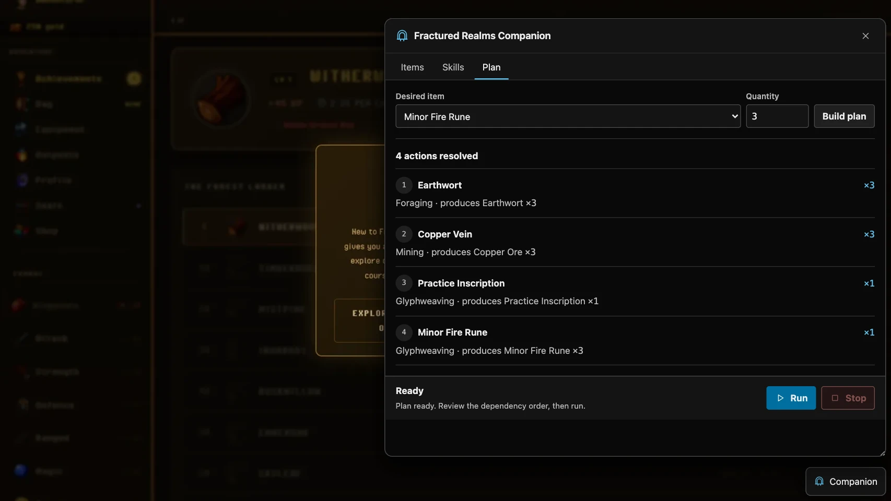

# Fractured Realms Companion

Fractured Realms Companion adds a local item wiki and action planner to [Fractured Realms](https://store.steampowered.com/app/3789070/Fractured_Realms/). This unofficial tool is for Steam installations on Windows and Linux, or Steam inside CrossOver on macOS.

Search item sources and uses, plan crafting dependencies against your live inventory, and run the next available game action. You can interrupt execution, and steps that need a purchase or another manual action stay visible.

[Download a standalone release](https://github.com/glockyco/fractured-realms-companion/releases/latest).



The planner shows action progress, dependencies, and steps that need your attention.

## Install and start

Install Fractured Realms through Steam first. Download the binary for your platform and `SHA256SUMS` from the release page. Standalone binaries include their runtime and do not need Node.js or Bun.

Verify the downloaded binary against its entry in `SHA256SUMS`. On Linux or macOS, give it executable permission. Rename it to `fractured-companion` (`fractured-companion.exe` on Windows) and put it on your `PATH` to use the commands below. Alternatively, replace `fractured-companion` with the downloaded binary's full path.

The macOS binaries are unsigned. If macOS blocks one, use System Settings, Privacy & Security, Open Anyway for that binary. Do not disable Gatekeeper globally.

```sh
fractured-companion doctor --json
fractured-companion refresh
fractured-companion doctor
fractured-companion launch
```

The first diagnostic is read-only and can report missing companion state before your first refresh. `refresh` extracts game data and patches the installed game archive. Continue to `launch` only after `doctor` reports no blocking failures. A warning is not blocking, but missing game data can affect plans.

`launch` starts the refreshed game and opens the companion in your browser. It does not refresh or patch the game itself.

## Steam discovery

The companion searches Steam installations and their library folders. Linux launch support needs the `steam` command or a detected Flatpak Steam installation. macOS support targets CrossOver, not a native macOS game installation, and expects CrossOver in its standard Applications location.

If discovery does not find your installation, select the Steam root or CrossOver bottle explicitly:

```sh
fractured-companion doctor --steam-root "/path/to/Steam" --json
fractured-companion launch --bottle MySteam --no-open
```

See [the discovery implementation](src/platform/steam.ts) for searched locations and bottle defaults. Run `fractured-companion --help` for CLI options. Command-specific flags must follow their command.

## Find items and run a plan

In the companion, search for an item to inspect sources, uses, stats, and requirements. The skill view compares actions and their inputs, outputs, tools, and timing.

Add a target to the planner and review the dependency timeline before starting execution. The executor chooses the highest-priority action that can run now. Manual steps do not stop independent work. Use the stop controls to interrupt it.

Rare-drop counts and completion times are estimates. Required shop unlocks need your intervention. Starting a planned action stops active combat, and game checks can refuse an action or block it when inventory space is unavailable.

## Update or remove the patch

After a Steam game update, close the game and run:

```sh
fractured-companion refresh
fractured-companion doctor
fractured-companion launch
```

To update an already-running companion session, use `fractured-companion relaunch`. It requests shutdown from the project-owned companion, refreshes, and launches again. If shutdown fails, close the game manually before retrying.

To remove the patch:

```sh
fractured-companion restore
```

Patching and restoration verify archive fingerprints, patch ownership, Steam build metadata, and the original backup. If a check refuses an unknown build or foreign patch, do not bypass it. If a separate tool previously patched the archive, restore it with that tool first.

## What it changes

`refresh` patches the game's Electron ASAR archive and keeps a verified original backup. It writes extracted game data, the overlay pack, and patch metadata outside the game installation. [State-path selection](src/platform/state.ts) defines where these files live. `restore` uses the verified backup rather than downloading game files.

The companion serves its browser UI on loopback only. Direct execution uses live game controls rather than bypassing game requirements. Game updates can make extraction incomplete or make patching unsafe. Read diagnostic warnings before relying on a plan.

To extract data without patching the game, then inspect it:

```sh
fractured-companion refresh --no-patch
fractured-companion model info
fractured-companion model sql "SELECT id, level_req FROM actions WHERE skill_id='woodcutting' ORDER BY level_req LIMIT 3"
```

The JSON model is canonical. The SQLite projection and SQL command require an available built-in SQLite driver. `model info` reports paths and extraction gaps.

### Publish a data spreadsheet

The optional publisher sends the compiled SQLite model to Google Sheets. It requires a built-in SQLite driver even for a dry run:

```sh
npm run export-sheets -- --dry-run
```

To publish, enable the Google Sheets API, create a service-account JSON key, and share a spreadsheet with that account as Editor. Set `FRACTURED_SHEETS_CREDENTIALS` to the key's path and `FRACTURED_SHEETS_SPREADSHEET_ID` to the spreadsheet ID before running `npm run export-sheets`. The publisher remembers the spreadsheet ID for later runs. See [the publisher](scripts/export-sheets.mjs) for configuration and credential lookup.

Publishing clears and rewrites model tabs and deletes tabs not present in the model, except when deletion would empty the workbook. Keep analysis in a separate spreadsheet. Check the final summary for failed writes.

## Development and further reading

Use the Node.js version in [CI](.github/workflows/ci.yml):

```sh
npm ci
npm test
npm run build
npx tsc --noEmit
```

Read [AGENTS.md](AGENTS.md) for architecture, scoped tests, generated-file rules, and live-game safety boundaries. [PRODUCT.md](PRODUCT.md) describes the product scope, and [DESIGN.md](DESIGN.md) covers the overlay UI. [The Steam guide source](docs/steam-guide/README.md) contains the public spreadsheet guide.

Live validation is separate from the ordinary checks. It patches and drives a real installation. Read the safety instructions in AGENTS.md and take a save backup before running it. Screenshot tooling also drives the game and overwrites committed images. Release targets and publishing behavior live in [the release workflow](.github/workflows/release.yml).

## License

[MIT](LICENSE).
